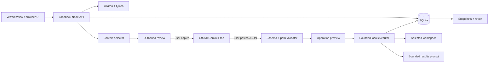

# Orbit architecture

## Product boundaries

Project mode and Offline mode have separate responsibilities. Offline mode sends chat only to the loopback Ollama service. Project mode does not depend on the local model: it selects relevant files deterministically, builds a reviewed prompt for Gemini, validates the returned operation plan, and executes locally.

Orbit does not control or scrape Gemini. It stores no Google credentials, cookies, or browser tokens. The user is the trust boundary between Orbit and the official website and can inspect or edit all outbound material.

## Project task lifecycle

1. `prepareHandoff` scans a bounded project tree, excludes protected and binary paths, ranks relevant text files from task terms, includes reviewed text attachments, lists image attachments, and flags secret-like values.
2. Gemini returns one `orbit-response-v1` JSON object containing a summary, ordered operations, verification commands, and a follow-up flag.
3. `validateHandoff` caps payloads, normalizes relative paths, rejects traversal and protected directories, and classifies risky commands.
4. The UI displays operations before execution. Risky operations require the user to approve the highlighted category.
5. `applyHandoff` takes pre-change snapshots, applies file operations in order, runs commands without a shell, caps output, enforces timeouts, and streams activity.
6. SQLite records the task, response, results, verification state, and snapshots. Revert restores edited/deleted files and removes created files.
7. Follow-up prompts contain bounded output and the remaining problem for another Gemini round.

## Main interfaces

- `POST /api/handoff/prepare`
- `POST /api/handoff/validate`
- `POST /api/handoff/apply`
- `POST /api/handoff/follow-up`
- `POST /api/tasks/:id/revert`
- `POST /api/workspace/assets`
- `POST /api/chats/:id/documents`
- `POST /api/chats/:id/generate` for Offline mode

## Security controls

- Loopback-only binding with Host and Origin validation.
- Workspace canonicalization and symlink escape checks.
- Protected `.git`, dependency, and Orbit data directories.
- Executable-plus-arguments commands; no implicit shell parsing.
- Confirmation for deletion, installs, network tools, shell interpreters, and destructive commands.
- Payload, file, output, command count, and timeout limits.
- SQLite transactions and owner-local data storage.
- Secret-like outbound context warnings and an exact review surface.

The executor is a local coding tool, so approved commands can modify the chosen workspace. Model output remains fallible and should be reviewed.
